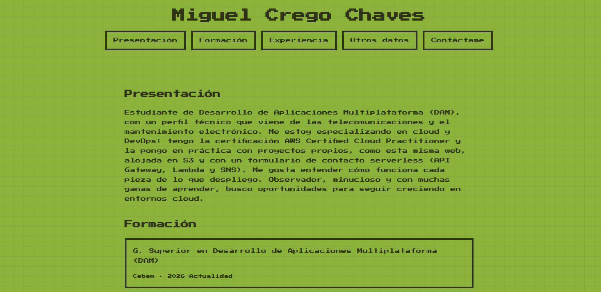
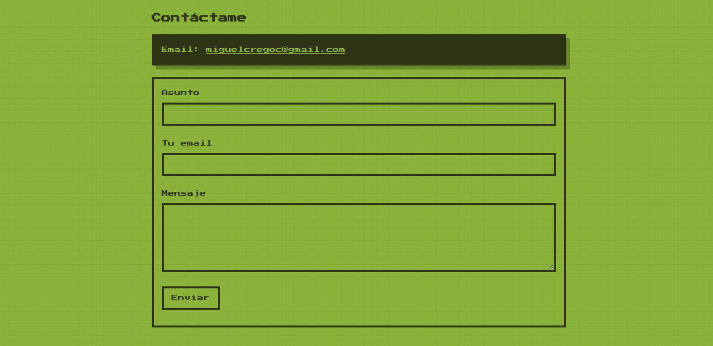
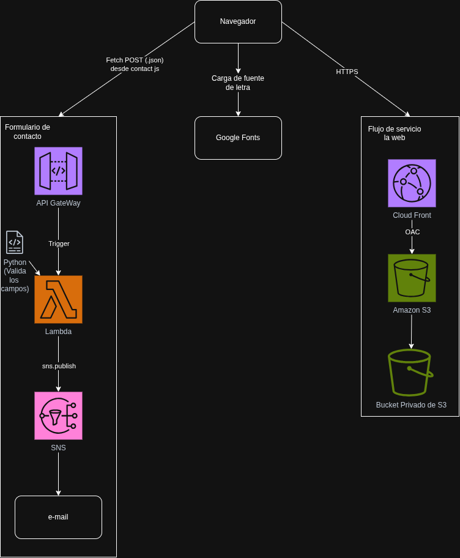

# Curriculum personal con cuestionario serverless en AWS

Curriculum web alojado en un bucket S3 distribuido mediante CloudFront con cuestionario serverless realizado con Amazon Lambda y API GateWay para la recepcion de correos mediante SNS.

Importante: La estructura de este proyecto es meramente explicativa, por ejemplo code_lambda.py esta incrustado en la funcion lambda.

## Vista del proyecto

## Arquitectura

## Servicios de AWS
