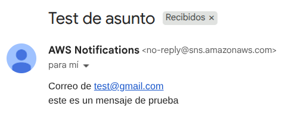

# Curriculum personal con cuestionario serverless en AWS

Curriculum web alojado en un bucket de S3 distribuido mediante CloudFront con cuestionario serverless realizado con Amazon Lambda y API GateWay para la recepcion de correos mediante SNS.

Importante: La estructura de este proyecto es meramente explicativa, por ejemplo `code_lambda.py` esta incrustado en la funcion lambda.

## Vista del proyecto

*Figura 1. Vista inicial de la pagina.*
*Figura 2. Vista del cuestionario.*
*Figura 3. Vista de email recibido.

## Arquitectura

*Figura 4. Diagrama de flujo de la web*

## Servicios de AWS usados


| Servicio | Para qué lo uso | Por qué lo elegí |
|---|---|---|
| **Amazon S3** | Almacena los archivos de la web (HTML, CSS, JavaScript e imágenes). | Ya que la web es estatica, usar un bucket de S3 es la forma mas sencilla y barata, sin servidores que mantener. El bucket es privado. |
| **Amazon CloudFront** | Sirve la web por HTTPS y la cachea cerca del visitante. | S3 por sí solo no ofrece HTTPS en su endpoint de sitio web. Con *Origin Access Control* (OAC), solo CloudFront puede leer el bucket. |
| **Amazon API Gateway** | Recibe el `POST /contacto` del formulario y lanza la Lambda. | Expone una API pública sin gestionar servidores y permite limitar el número de peticiones. |
| **AWS Lambda** | Valida los datos del formulario (tipo, vacío, longitud) y los publica en SNS. | Solo se ejecuta cuando alguien envía el formulario. La variable de entorno `TOPIC_ARN` evita escribir datos de la cuenta en el código, se guarda en la consola de AWS. |
| **Amazon SNS** | Reenvía cada mensaje del formulario a mi correo. | Es la forma más simple de enviar una notificación por email sin montar un servidor de correo. |
| **AWS IAM** | Da a Lambda un rol propio con permiso solo para publicar (`sns:Publish`) en su topic. | La uso para aplicar el principio de mínimo privilegio: Lambda solo puede publicar. |
| **AWS Budgets** | Presupuesto Zero-Spend que avisa si hay cualquier gasto. | Ya que uso el plan gratuito con el crédito inicial que da AWS a las cuentas de nueva creación este servicio me mantiene dentro de los margenes y me notifica si algo se desvia de ahí. |

## API del formulario

El formulario envía los datos a una API creada con API Gateway, que lanza la función Lambda.

**Endpoint**

| | |
|---|---|
| Método | `POST` |
| Ruta | `/contacto` |
| Cabecera | `Content-Type: application/json` |

**Cuerpo de la petición (JSON)**

`asunto` máx. 99 caracteres

`email` máx. 150 caracteres

`mensaje` máx. 1000 caracteres

Ejemplo:

```json
{
  "asunto": "Hola",
  "email": "ejemplo@gmail.com",
  "mensaje": "Me gustaría contratarte."
}
```

**Respuestas**

| Código | Cuándo ocurre | Cuerpo |
|---|---|---|
| `200` | El mensaje se ha publicado en SNS | `{"mensaje": "mensaje enviado"}` |
| `400` | JSON roto o vacío, campos que no son texto, o campos vacíos o demasiado largos | `{"mensaje": "..."}` con el motivo |
| `500` | Falla la publicación en SNS | `{"mensaje": "no se pudo enviar el mensaje"}` |

A parte de Lambda, el propio html tambien valida que los contenidos introducidos por el usuario sean los correctos, y da avisos cuando se detacta algun error.

## Función Lambda (`code_lambda.py`)

Esta función en Python se ejecuta cada vez que alguien envía el formulario de contacto. Recibe los datos desde API Gateway, comprueba que son correctos y, si lo son, los publica en un topic de SNS para que me lleguen por correo.

**Cómo funciona, paso a paso:**

1. **Preparación.** Al arrancar, crea un cliente de SNS con `boto3`, la libreria de AWS para python y lee el ARN del topic desde la variable de entorno `TOPIC_ARN`. Así no hay datos de mi cuenta escritos en el código. Esto se hace fuera de la función principal para que se pueda reutilizar entre ejecuciones.
2. **Lectura de la petición.** Coge el `body` que manda API Gateway (un texto en JSON) y lo convierte en un diccionario. Si está vacío o el JSON no es válido, responde con un error `400`.
3. **Extracción y comprobación de tipos.** Saca los tres campos del formulario (`asunto`, `email` y `mensaje`) y comprueba que sean texto. Si no lo son, responde `400`.
4. **Limpieza.** Quita los espacios sobrantes al principio y al final de cada campo.
5. **Validación.** Comprueba que ningún campo esté vacío y que no se pase de la longitud máxima (99 caracteres el asunto, 150 el email y 1000 el mensaje). Si algo falla, responde `400` indicando qué campo es el incorrecto.
6. **Preparación del mensaje.** Sustituye los saltos de línea del asunto por espacios (SNS no los admite en el asunto) y monta el cuerpo del correo con el email de quien escribe seguido del mensaje.
7. **Envío.** Publica el mensaje en SNS con `sns.publish`. Si falla, responde `500`. Si todo va bien, responde `200`.

La función usa el rol de IAM de la Lambda, que solo tiene permiso para publicar (`sns:Publish`) en ese topic, así que no hay claves de acceso en el código y como explque en el punto anterior pongo en practica el principio de minimo privilegio tal como recomienda AWS.

## Como desplegar

Este proyecto no fue pensado con la idea de tener una replicacion facilmente replicable (tengo en mente realizar proyectos que aborden este tema para ahondar en ello), pero aun asi este punto es una guia a seguir para quien quiera replicar lo explicado en este repo. No lo especifico, pero obviamente hace falta cambiar la informacion personal por la de quien quiera replicarlo.

El proyecto se despliega a mano desde la consola de AWS. Uso la región `eu-north-1` (Estocolmo), pero vale cualquiera mientras sea la misma para todos los servicios, excepto CloudFront, que es global.

### 1. Topic de SNS

1. Crea un topic de tipo **Standard**.
2. Crea una suscripción de tipo email con tu correo.

### 2. Rol de IAM para la Lambda

1. Crea un rol para el servicio Lambda y ponle nombre para identificarlo facilmente.
2. Dale permisos mínimos: sns:Publish.

### 3. Función Lambda

1. Crea una función con runtime Python y asígnale el rol anterior.
2. Pega el contenido de `code_lambda.py`.

### 4. API Gateway

1. Crea una HTTP API con una ruta POST /contacto integrada con la Lambda.

### 5. Conectar el formulario con la API

En contact.js, cambia el valor de `API_URL` por tu Invoke URL seguida de `/contacto`, sin barra final.

### 6. Bucket de S3

1. Crea un bucket y sube `index.html`, `contact.js`, la carpeta `stiles/` y la carpeta `img/`.
2. Deja activado Block all public access para que el bucket se mantenga privado y acceder solo mediante CloudFront

### 7. CloudFront

1. Crea una distribución cuyo origen sea el bucket (el endpoint normal de S3, **no** el de sitio web) y activa **Origin Access Control**.
2. En **Default root object**, pon `index.html`.
3. Copia la política que te propone CloudFront y pégala en la **Bucket policy** del bucket, para que solo CloudFront pueda leer los archivos.
4. Cuando el estado sea **Deployed**, la web estará en `https://<id>.cloudfront.net`.

### 8. CORS

En la configuración de CORS de la API, permite como origen el dominio de CloudFront del paso anterior. Sin esto, el navegador bloquea el envío del formulario.

## Autor

Proyecto creado por **Miguel Crego Chaves**, estudiante de Desarrollo de Aplicaciones Multiplataforma (DAM) con interés en cloud y DevOps.

- LinkedIn: [Miguel Crego Chaves](https://www.linkedin.com/in/miguel-crego-chaves-b8348743b/)
- GitHub: [miguelcregoc](https://github.com/miguelcregoc)


